# Домашнее задание по Docker

Работа выполнена в Ubuntu WSL 2 с Docker Desktop и Docker Compose plugin.

## Задание 1. Образ `custom-nginx`

`task1/Dockerfile`:

```dockerfile
FROM nginx:1.29.0
COPY index.html /usr/share/nginx/html/index.html
```

`task1/index.html`:

```html
<html>
<head>
Hey, Netology
</head>
<body>
<h1>I will be DevOps Engineer!</h1>
</body>
</html>
```

Образ собран с тегом `custom-nginx:1.0.0`. Репозиторий: [uthstars01/custom-nginx](https://hub.docker.com/repository/docker/uthstars01/custom-nginx/general).

## Задание 2. Запуск и переименование

Контейнер был запущен в фоне с публикацией `127.0.0.1:8080:80`, затем переименован в `custom-nginx-t2`. Проверены контейнер, порт, лог nginx, Base64-содержимое страницы и доступность по `curl`.

<details><summary>Скриншоты задания 2</summary>

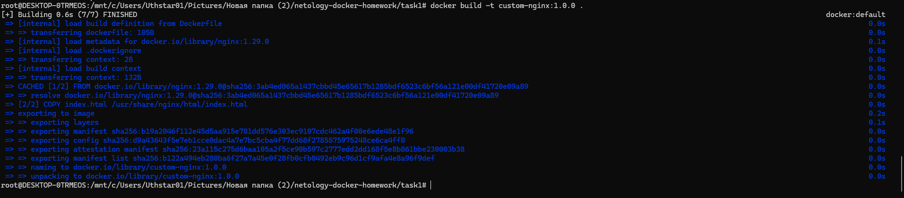
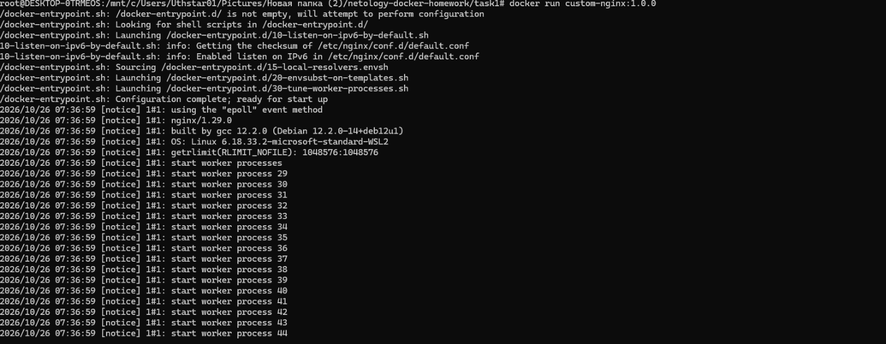
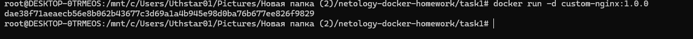
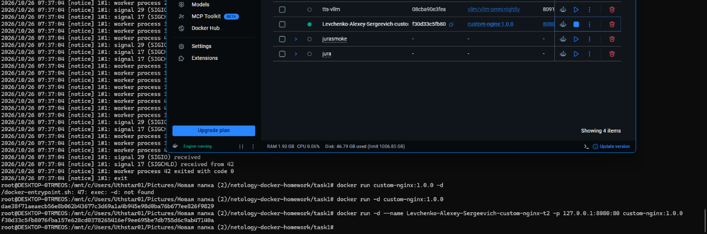
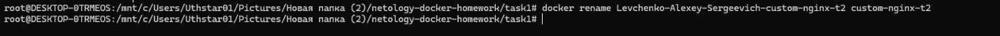
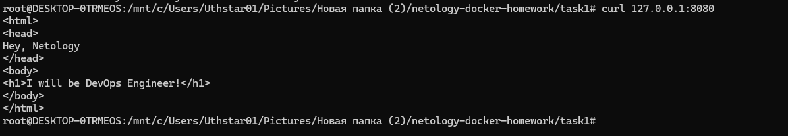

</details>

## Задание 3. Потоки контейнера и изменение порта nginx

Для подключения к основному процессу контейнера использована команда:

```bash
docker attach custom-nginx-t2
```

После `Ctrl-C` завершился главный процесс nginx (PID 1), поэтому Docker остановил контейнер: контейнер существует, пока работает его основной процесс.

В контейнере установлены `nano` и `curl`; в `/etc/nginx/conf.d/default.conf` оба `listen 80` изменены на `listen 81`. После `nginx -s reload` запрос к `127.0.0.1:80` внутри контейнера не проходит, а к `127.0.0.1:81` возвращает страницу.

Проблема доступа с хоста: Docker продолжает направлять `127.0.0.1:8080` на внутренний порт `80`, но nginx уже слушает `81`. Поэтому `docker port` показывает сопоставление с `80`, а `curl http://127.0.0.1:8080` не работает.

Для удаления работающего контейнера без отдельной остановки применяется:

```bash
docker rm -f custom-nginx-t2
```

<details><summary>Скриншоты задания 3</summary>

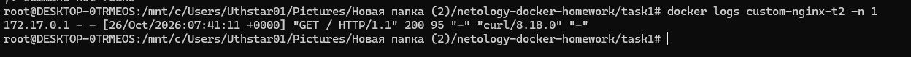
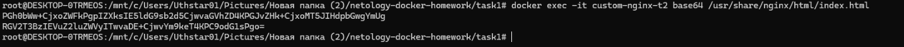
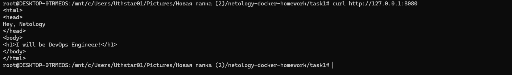
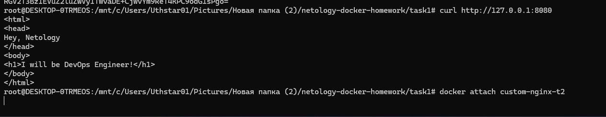
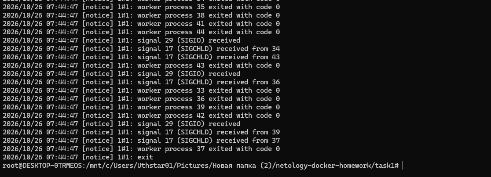
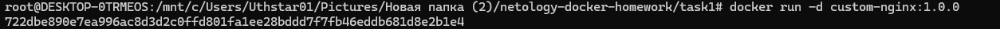
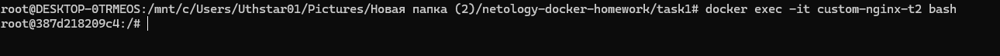
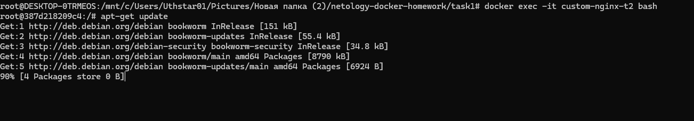
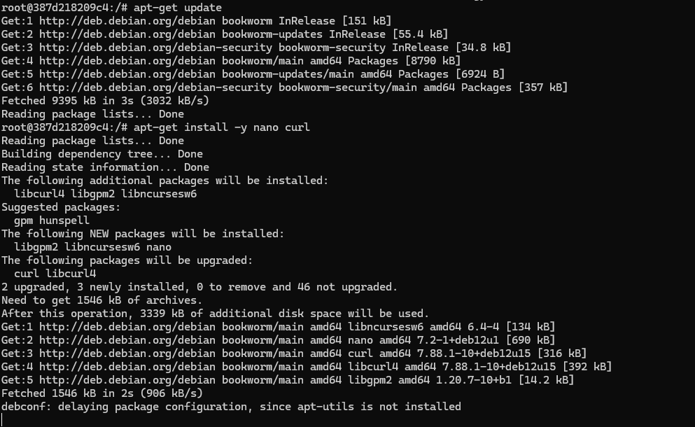
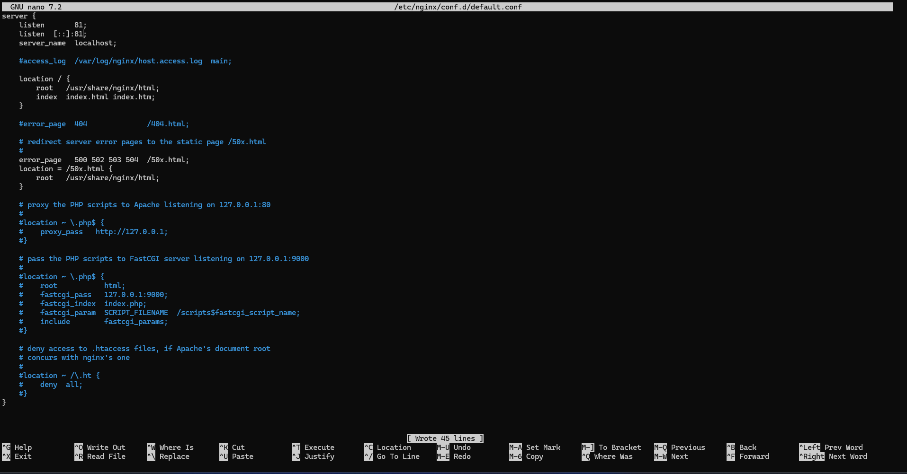
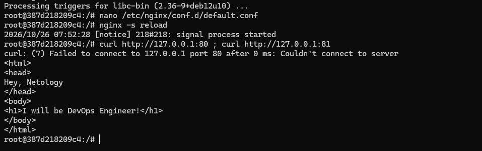
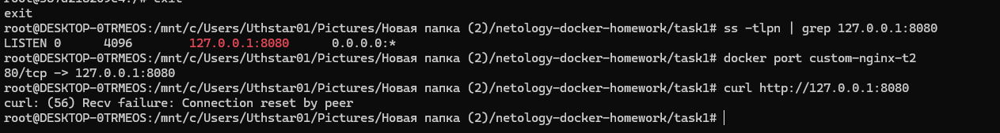
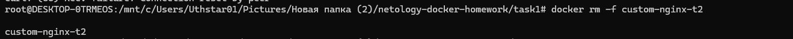

</details>

## Задание 4. Общий bind mount

Созданы два фоновых контейнера с подключением текущего каталога хоста в `/data`:

```bash
docker run -d --name centos-task4 -v "$(pwd):/data" centos:7 sleep infinity
docker run -d --name debian-task4 -v "$(pwd):/data" debian:bookworm-slim sleep infinity
```

В CentOS создан `/data/from-centos.txt`, на хосте — `from-host.txt`. В Debian видны эти два файла и исходный `host-file.txt`, что подтверждает работу общего bind mount.

<details><summary>Скриншоты задания 4</summary>

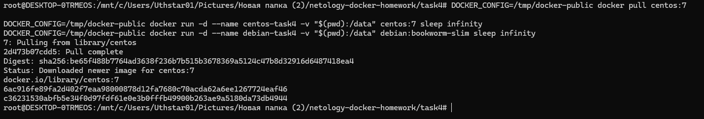
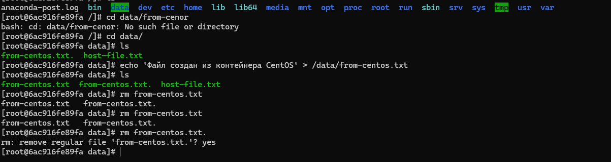
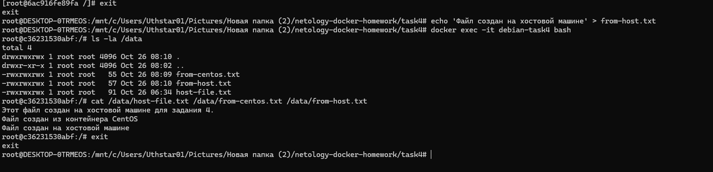

</details>

## Задание 5. Compose, registry и Portainer

### Выбор Compose-файла

Docker Compose предпочитает канонический файл `compose.yaml`, когда рядом есть оба допустимых имени. В итоговый `compose.yaml` добавлен `include`, поэтому в модель приложения включается сервис `registry` из `docker-compose.yaml`.

`task5/compose.yaml`:

```yaml
version: "3"
include:
  - docker-compose.yaml
services:
  portainer:
    network_mode: host
    image: portainer/portainer-ce:latest
    volumes:
      - /var/run/docker.sock:/var/run/docker.sock
```

`task5/docker-compose.yaml`:

```yaml
version: "3"
services:
  registry:
    image: registry:2
    ports:
      - "5000:5000"
```

### Локальный registry

```bash
docker tag custom-nginx:1.0.0 127.0.0.1:5000/custom-nginx:latest
docker push 127.0.0.1:5000/custom-nginx:latest
```

Образ успешно отправлен в локальный registry с тегом `latest`.

### Стек Portainer

В Portainer создан стек `custom-nginx-stack`:

```yaml
version: '3'
services:
  nginx:
    image: 127.0.0.1:5000/custom-nginx:latest
    ports:
      - "9090:80"
```

Контейнер `custom-nginx-stack-nginx-1` создан, имеет статус `running` и публикацию `9090:80`.

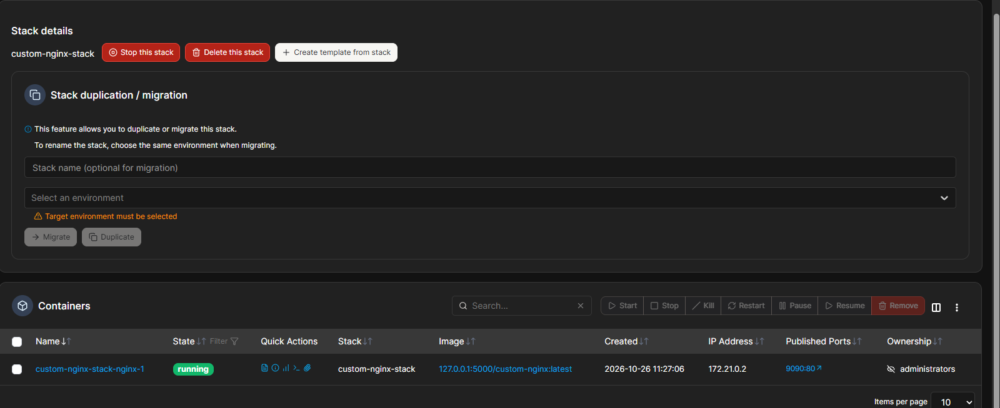

В Inspect раскрыт `Config`; на скриншоте видны поля от `AppArmorProfile` до `Driver`.

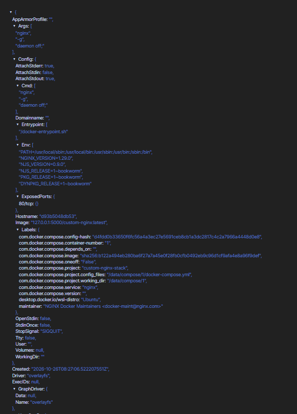

### Orphan-контейнеры и остановка проекта

После удаления `compose.yaml` Compose использует оставшийся `docker-compose.yaml`. Контейнер Portainer остаётся запущенным, но его сервис больше не описан текущей конфигурацией — поэтому появляется предупреждение об orphan-контейнере. Предложенное действие выполнено командой:

```bash
docker compose up -d --remove-orphans
```

Проект погашен одной командой:

```bash
docker compose down --remove-orphans
```

Файл `compose.yaml` восстановлен для сдачи.

<details><summary>Консольные скриншоты задания 5</summary>

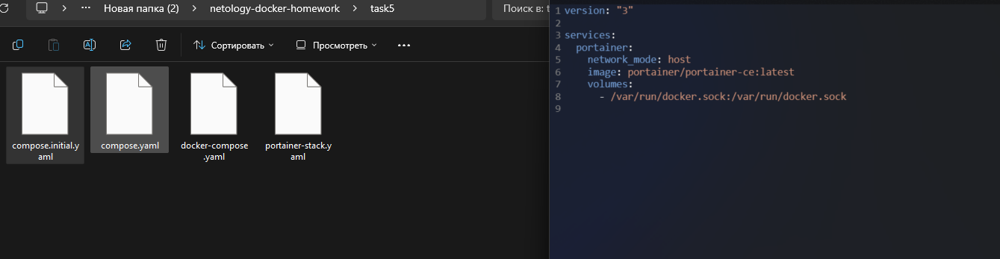
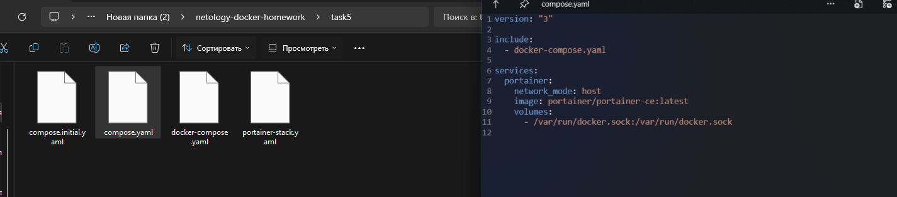
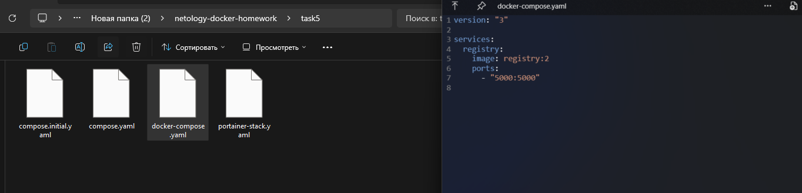
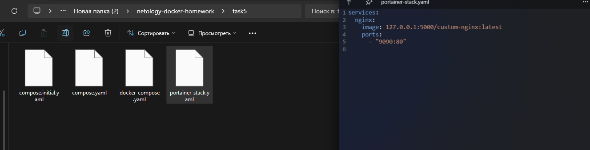
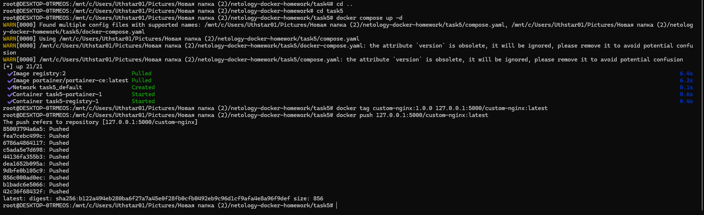
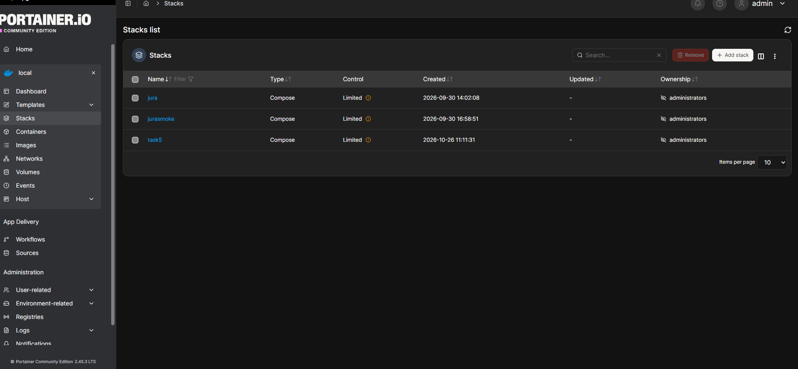
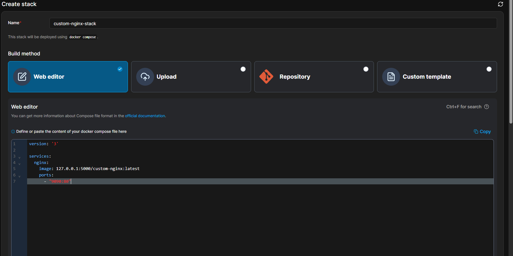
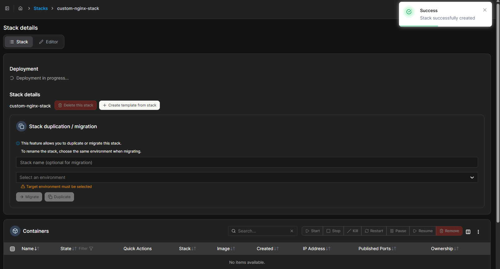
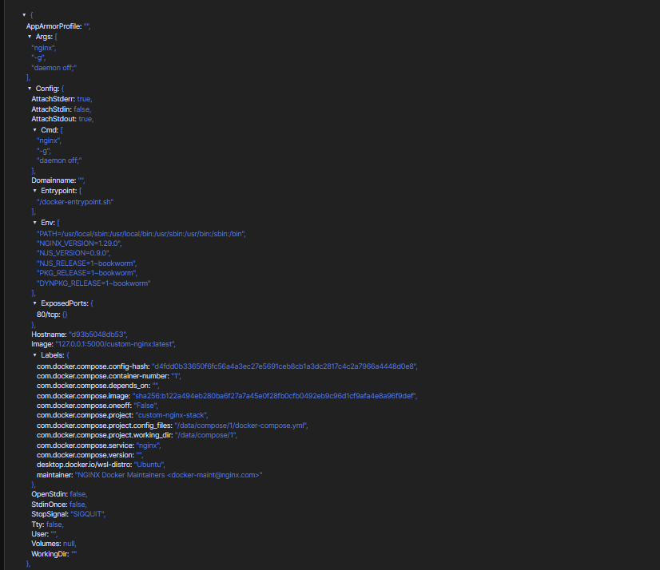
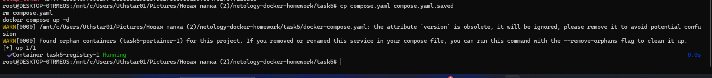
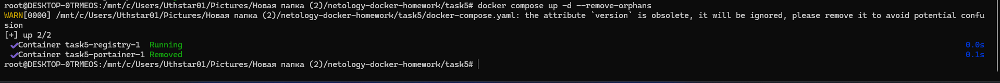
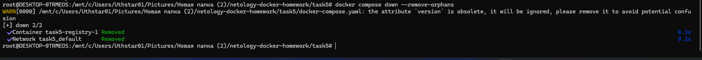
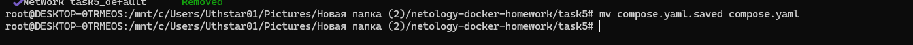

</details>
"# netology-docker-homework" 
